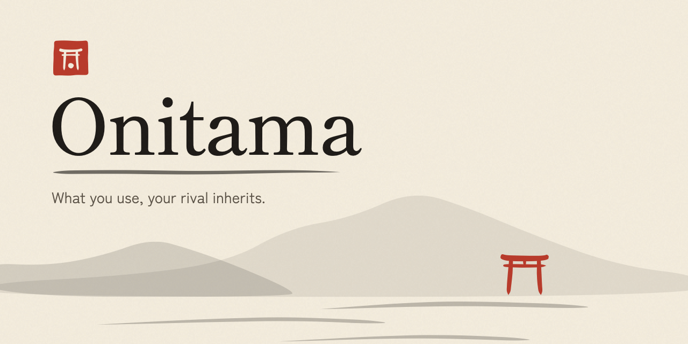

# Onitama

A pass-and-play hotseat implementation of the Onitama board game: a single
Vite + React + TypeScript single-page app with **no server, no backend, no
sockets**. One device, two players sitting opposite each other. Installable
as a PWA and fully playable offline after the first load.

**This is a local build only** — it is not deployed anywhere yet. When it is,
the Vite `base` is `'./'` (relative), so the same build works under any
GitHub Pages path.

## The game

5×5 shrine board. Each player (Red and Blue) commands five pawns — a master
and four students — starting on their home row with the master on the temple
square. Sixteen move cards exist; each game deals two to each player plus one
side card whose stamp colour decides who starts.

- **Win** by capturing the opposing master (*Way of the Stone*) or by moving
  your master onto the opposing temple square (*Way of the Stream*).
- **A turn:** pick one of your two cards, move one pawn by one of its offsets
  (offsets are from the card holder's perspective — cards rotate 180° when
  they change sides), then swap the used card with the side card.
- Landing on an opposing pawn captures it; you can't land on your own pawn.
- **Forced pass:** if neither card gives you a legal move, you exchange one
  of your cards with the side card without moving (official rule).

Indigo (`blue` in the engine) plays from the bottom of the screen; Vermilion
(`red`) plays from the top, with its cards and messages turned 180° to face
that player, just like the physical game.

## Card data source

The 16 cards' move grids and starting-player stamps were verified against the
[onitamago](https://pkg.go.dev/github.com/andersfylling/onitamago) open-source
reference implementation (card bitboards) and cross-checked against the
official rulebook (Arcane Wonders) for setup, the pass rule, and both win
conditions. Individual cards were spot-checked against published card photos
and reviews (Tiger, Mantis, Goose/Rooster). The data lives in
`src/game/cards.ts`, expressed as `[dx, dy]` offsets from the holder's
perspective (dy+ = forward). All art and styling in this build are original —
only card names and move data (rule data) are used.

## Art direction

*A ceremonial duel on washi: the side card lies in front of the player who
inherits it, already facing them.* After every move the used card crosses the
table on a curve, making its half turn, and settles in the rival's tray. That
crossing is the one signature moment; everything else stays quiet.

- **Colour** lives in tokens at the top of `src/index.css`: paper, sumi ink, shu
  vermilion, ai indigo, muted gold, tatami. Night dojo is a separate token set,
  not an inversion. Cards stay paper in both themes.
- **Never colour alone.** Vermilion carries a ring and a round seal; Indigo a
  diamond and a square seal. Students are round stones. Masters are pointed
  tablets whose tip faces the enemy.
- **Ink** is generated, not drawn by hand or traced. `scripts/gen-art.mjs` expands
  centre lines and pressure curves into filled brush strokes, then writes
  `src/art/generated.ts`. Run `node scripts/gen-art.mjs` after changing a stroke.
- **Type** is Shippori Mincho for display and Zen Kaku Gothic New for UI, both
  self-hosted Latin subsets (OFL, see `public/fonts/OFL.txt`).
- **Motion** is presentation only. `useDuelMotion` watches game state and animates
  the difference between two turns. Everything falls back to short fades under
  `prefers-reduced-motion`.

## Develop

```sh
npm install
npm run dev       # dev server
npm test          # engine test suite (Vitest)
npm run typecheck # tsc --noEmit
npm run build     # typecheck + production build into dist/
```

## Layout

```
index.html                  entry page (relative asset paths)
public/
  manifest.webmanifest      PWA manifest
  sw.js                     hand-rolled offline service worker
  fonts/                    self-hosted woff2 subsets and their licence
  icon.svg, icon-*.png      original icons (the torii seal)
scripts/
  gen-art.mjs               generates every brush mark in the game
src/
  main.tsx                  React entry + service worker registration
  App.tsx                   home and rules screens
  index.css                 tokens, themes, layout, motion
  schools.ts                display names, square names, moves in words
  theme.ts                  night dojo toggle
  art/
    generated.ts            generated SVG path data (do not edit)
    marks.tsx               seals, crests, pieces, torii, brush rules
  components/
    GameScreen.tsx          board, seats, trays, pass + win flows
    CardView.tsx            stance card rendering
    useDuelMotion.ts        card flight, piece travel, capture marks
  game/
    cards.ts                the 16 move cards (verified data) + rotation
    engine.ts               pure game engine (no UI dependencies)
    engine.test.ts          22 tests: setup, move generation incl. red
                            rotation, captures, both wins, forced pass,
                            card swap, and scripted full games played to a
                            win through the engine API
```
